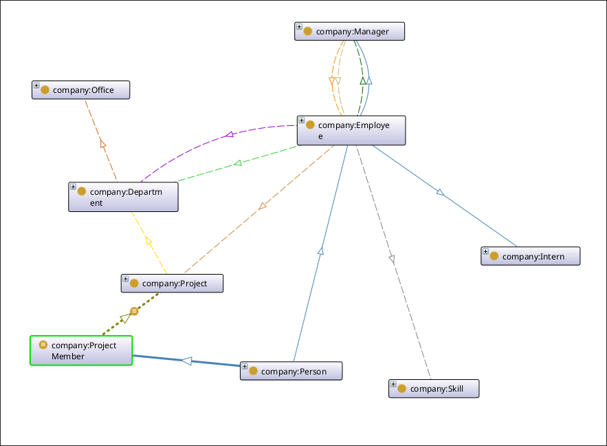

# Company Onthology using Protégé

| Team         |
| ------------ |
| Air Es Bepek |

| NRP        |
| ---------- |
| 5025221238 |
| 5025231233 |
| 5025231286 |



## SPARQL Queries

### Simple 1: employees who work in IT

```sparql
PREFIX rdf: <http://www.w3.org/1999/02/22-rdf-syntax-ns#>
PREFIX xsd: <http://www.w3.org/2001/XMLSchema#>
PREFIX company:  <http://www.semanticweb.org/air-es-bepek/ontologies/2026/9/company#>

SELECT ?employee
WHERE {
  ?employee company:worksIn company:IT .
}
```

### Simple 2: active projects and their budget

```sparql
PREFIX rdf: <http://www.w3.org/1999/02/22-rdf-syntax-ns#>
PREFIX xsd: <http://www.w3.org/2001/XMLSchema#>
PREFIX company:  <http://www.semanticweb.org/air-es-bepek/ontologies/2026/9/company#>

SELECT ?project ?budget
WHERE {
  ?project company:hasStatus "active" ;
           company:hasBudget ?budget .
}
```

### Complex 1 (UNION + ORDER BY): all managers and interns

```sparql
PREFIX rdf: <http://www.w3.org/1999/02/22-rdf-syntax-ns#>
PREFIX xsd: <http://www.w3.org/2001/XMLSchema#>
PREFIX company:  <http://www.semanticweb.org/air-es-bepek/ontologies/2026/9/company#>

SELECT ?person ?name
WHERE {
  { ?person rdf:type company:Manager }
  UNION
  { ?person rdf:type company:Intern }
  ?person company:hasFullName ?name .
}
ORDER BY ?name
```

### Complex 2 (OPTIONAL): every project with its owning department (if any)

```sparql
PREFIX rdf: <http://www.w3.org/1999/02/22-rdf-syntax-ns#>
PREFIX xsd: <http://www.w3.org/2001/XMLSchema#>
PREFIX company:  <http://www.semanticweb.org/air-es-bepek/ontologies/2026/9/company#>

SELECT DISTINCT ?project ?status ?department
WHERE {
  ?project rdf:type company:Project ;
           company:hasStatus ?status .
  OPTIONAL { ?project company:ownedBy ?department }
}
ORDER BY ?project
```

### Complex 3 (JOIN + FILTER): employees hired after 2021 with a skill, working on an active project

```sparql
PREFIX rdf: <http://www.w3.org/1999/02/22-rdf-syntax-ns#>
PREFIX xsd: <http://www.w3.org/2001/XMLSchema#>
PREFIX company:  <http://www.semanticweb.org/air-es-bepek/ontologies/2026/9/company#>

SELECT ?name ?hired ?skill ?project
WHERE {
  ?e company:hasFullName ?name ;
     company:hasHireDate ?hired ;
     company:hasSkill ?skill ;
     company:assignedTo ?project .
  ?project company:hasStatus "active" .
  FILTER (?hired > "2021-12-31"^^xsd:date)
}
ORDER BY ?hired
```

### Complex 4 (GROUP BY + COUNT + HAVING): headcount and average salary per department

```sparql
PREFIX rdf: <http://www.w3.org/1999/02/22-rdf-syntax-ns#>
PREFIX xsd: <http://www.w3.org/2001/XMLSchema#>
PREFIX company:  <http://www.semanticweb.org/air-es-bepek/ontologies/2026/9/company#>

SELECT ?department (COUNT(?e) AS ?headcount) (AVG(?salary) AS ?avgSalary)
WHERE {
  ?e company:worksIn ?department ;
     company:hasSalary ?salary .
}
GROUP BY ?department
HAVING (COUNT(?e) >= 2)
ORDER BY DESC(?headcount)
```

### Extra (property path, works without a reasoner): everyone who reports up to Rina, directly or not

```sparql
PREFIX rdf: <http://www.w3.org/1999/02/22-rdf-syntax-ns#>
PREFIX xsd: <http://www.w3.org/2001/XMLSchema#>
PREFIX company:  <http://www.semanticweb.org/air-es-bepek/ontologies/2026/9/company#>

SELECT ?name
WHERE {
  ?e company:reportsTo+ company:Rina ;
     company:hasFullName ?name .
}
ORDER BY ?name
```
