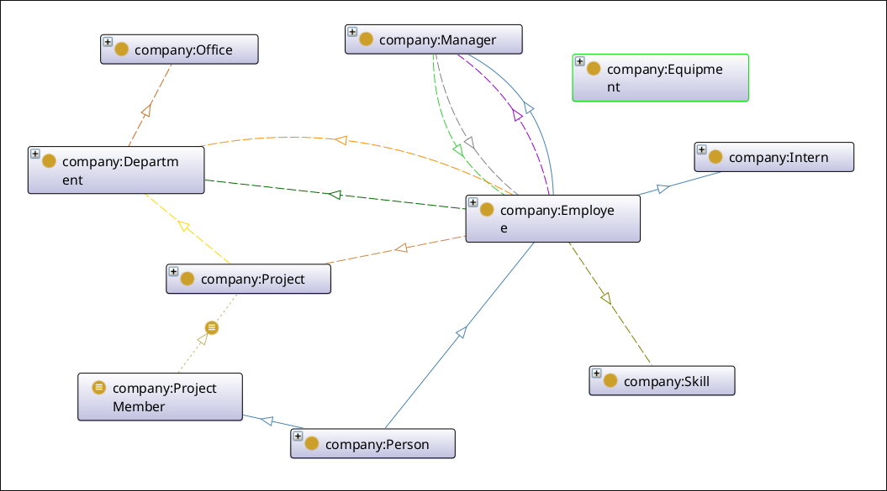
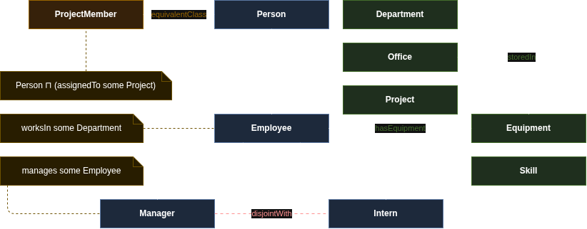

# Company Onthology using Protégé

| Team         |
| ------------ |
| Air Es Bepek |

| Name                          | NRP        |
| ----------------------------- | ---------- |
| Mohamad Valdi Ananda Tauhid   | 5025221238 |
| Muhammad Farrel Fathin Wibowo | 5025231233 |
| Kayana Danendra Kawiswara     | 5025231286 |



## Ontology Structure



### Classes

| Class           | Parent / Definition                                                    |
| --------------- | ---------------------------------------------------------------------- |
| `Person`        | -                                                                      |
| `Employee`      | `subClassOf Person`, `worksIn some Department`                         |
| `Manager`       | `subClassOf Employee`, `manages some Employee`, disjoint with `Intern` |
| `Intern`        | `subClassOf Employee`, disjoint with `Manager`                         |
| `Department`    | -                                                                      |
| `Office`        | -                                                                      |
| `Equipment`     | -                                                                      |
| `Project`       | -                                                                      |
| `Skill`         | -                                                                      |
| `ProjectMember` | `equivalentClass Person ⊓ (assignedTo some Project)`                   |

`Department`, `Equipment`, `Office`, `Person`, `Project`, and `Skill` are declared pairwise disjoint (`AllDisjointClasses`).

### Object Properties

| Property       | Domain       | Range        | Characteristics                  |
| -------------- | ------------ | ------------ | -------------------------------- |
| `assignedTo`   | `Employee`   | `Project`    | -                                |
| `hasEquipment` | `Employee`   | `Equipment`  | -                                |
| `hasSkill`     | `Employee`   | `Skill`      | -                                |
| `locatedIn`    | `Department` | `Office`     | -                                |
| `manages`      | `Manager`    | `Employee`   | inverse of `reportsTo`           |
| `ownedBy`      | `Project`    | `Department` | functional                       |
| `reportsTo`    | `Employee`   | `Manager`    | transitive, inverse of `manages` |
| `storedIn`     | `Equipment`  | `Office`     | -                                |
| `worksIn`      | `Employee`   | `Department` | functional                       |

### Data Properties

| Property          | Domain      | Range         | Characteristics |
| ----------------- | ----------- | ------------- | --------------- |
| `hasAssetTag`     | `Equipment` | `xsd:string`  | functional      |
| `hasBudget`       | `Project`   | `xsd:integer` | functional      |
| `hasEmail`        | `Person`    | `xsd:string`  | -               |
| `hasFullName`     | `Person`    | `xsd:string`  | functional      |
| `hasHireDate`     | `Employee`  | `xsd:date`    | functional      |
| `hasPurchaseDate` | `Equipment` | `xsd:date`    | functional      |
| `hasSalary`       | `Employee`  | `xsd:integer` | functional      |
| `hasStatus`       | `Project`   | `xsd:string`  | functional      |
| `hasValue`        | `Equipment` | `xsd:integer` | functional      |

### Individuals

| Individual       | Type         |
| ---------------- | ------------ |
| `Accounting`     | `Skill`      |
| `BandungOffice`  | `Office`     |
| `BrandCampaign`  | `Project`    |
| `BudgetSystem`   | `Project`    |
| `Budi`           | `Manager`    |
| `Citra`          | `Manager`    |
| `Design`         | `Skill`      |
| `Dian`           | `Manager`    |
| `Eko`            | `Manager`    |
| `Fajar`          | `Employee`   |
| `Finance`        | `Department` |
| `Gita`           | `Employee`   |
| `HR`             | `Department` |
| `Hadi`           | `Employee`   |
| `IT`             | `Department` |
| `Indah`          | `Employee`   |
| `InternalWiki`   | `Project`    |
| `JakartaHQ`      | `Office`     |
| `Joko`           | `Intern`     |
| `Laptop001`      | `Equipment`  |
| `Laptop002`      | `Equipment`  |
| `Marketing`      | `Department` |
| `OfficeChair001` | `Equipment`  |
| `Python`         | `Skill`      |
| `Rina`           | `Manager`    |
| `Rust`           | `Skill`      |
| `WebsitePortal`  | `Project`    |

## SPARQL Queries

### Simple 1: employees who work in IT

```sparql
PREFIX rdf: <http://www.w3.org/1999/02/22-rdf-syntax-ns#>
PREFIX xsd: <http://www.w3.org/2001/XMLSchema#>
PREFIX company:  <http://www.semanticweb.org/air-es-bepek/ontologies/2026/9/company#>

SELECT ?employee
WHERE {
  ?employee company:worksIn company:IT .
}
```

Output:

| `?employee`     |
| --------------- |
| `company:Budi`  |
| `company:Eko`   |
| `company:Fajar` |
| `company:Joko`  |

### Simple 2: active projects and their budget

```sparql
PREFIX rdf: <http://www.w3.org/1999/02/22-rdf-syntax-ns#>
PREFIX xsd: <http://www.w3.org/2001/XMLSchema#>
PREFIX company:  <http://www.semanticweb.org/air-es-bepek/ontologies/2026/9/company#>

SELECT ?project ?budget
WHERE {
  ?project company:hasStatus "active" ;
           company:hasBudget ?budget .
}
```

Output:

| `?project`              | `?budget` |
| ----------------------- | --------- |
| `company:BudgetSystem`  | `30000`   |
| `company:WebsitePortal` | `50000`   |

### Simple 3: equipment and where it's stored

```sparql
PREFIX rdf: <http://www.w3.org/1999/02/22-rdf-syntax-ns#>
PREFIX xsd: <http://www.w3.org/2001/XMLSchema#>
PREFIX company:  <http://www.semanticweb.org/air-es-bepek/ontologies/2026/9/company#>

SELECT ?equipment ?office
WHERE {
  ?equipment company:storedIn ?office .
}
ORDER BY ?equipment
```

Output:

| `?equipment`             | `?office`               |
| ------------------------ | ----------------------- |
| `company:Laptop001`      | `company:BandungOffice` |
| `company:Laptop002`      | `company:BandungOffice` |
| `company:OfficeChair001` | `company:JakartaHQ`     |

### Complex 1 (UNION + ORDER BY): all managers and interns

```sparql
PREFIX rdf: <http://www.w3.org/1999/02/22-rdf-syntax-ns#>
PREFIX xsd: <http://www.w3.org/2001/XMLSchema#>
PREFIX company:  <http://www.semanticweb.org/air-es-bepek/ontologies/2026/9/company#>

SELECT ?person ?name
WHERE {
  { ?person rdf:type company:Manager }
  UNION
  { ?person rdf:type company:Intern }
  ?person company:hasFullName ?name .
}
ORDER BY ?name
```

Output:

| `?person`       | `?name`         |
| --------------- | --------------- |
| `company:Budi`  | `Budi Santoso`  |
| `company:Citra` | `Citra Lestari` |
| `company:Dian`  | `Dian Pratama`  |
| `company:Eko`   | `Eko Nugroho`   |
| `company:Joko`  | `Joko Susilo`   |
| `company:Rina`  | `Rina Wijaya`   |

### Complex 2 (OPTIONAL): every project with its owning department (if any)

```sparql
PREFIX rdf: <http://www.w3.org/1999/02/22-rdf-syntax-ns#>
PREFIX xsd: <http://www.w3.org/2001/XMLSchema#>
PREFIX company:  <http://www.semanticweb.org/air-es-bepek/ontologies/2026/9/company#>

SELECT DISTINCT ?project ?status ?department
WHERE {
  ?project rdf:type company:Project ;
           company:hasStatus ?status .
  OPTIONAL { ?project company:ownedBy ?department }
}
ORDER BY ?project
```

Output:

| ?project                | ?status     | ?department         |
| ----------------------- | ----------- | ------------------- |
| `company:BrandCampaign` | `completed` | `company:Marketing` |
| `company:BudgetSystem`  | `active`    | `company:Finance`   |
| `company:InternalWiki`  | `planned`   |                     |
| `company:WebsitePortal` | `active`    | `company:IT`        |

### Complex 3 (JOIN + FILTER): employees hired after 2021 with a skill, working on an active project

```sparql
PREFIX rdf: <http://www.w3.org/1999/02/22-rdf-syntax-ns#>
PREFIX xsd: <http://www.w3.org/2001/XMLSchema#>
PREFIX company:  <http://www.semanticweb.org/air-es-bepek/ontologies/2026/9/company#>

SELECT ?name ?hired ?skill ?project
WHERE {
  ?e company:hasFullName ?name ;
     company:hasHireDate ?hired ;
     company:hasSkill ?skill ;
     company:assignedTo ?project .
  ?project company:hasStatus "active" .
  FILTER (STR(?hired) > "2021-12-31")
}
ORDER BY ?hired
```

| ?name            | ?hired                 | ?skill               | ?project                |
| ---------------- | ---------------------- | -------------------- | ----------------------- |
| `Gita Anggraini` | `2022-08-01^^xsd:date` | `company:Accounting` | `company:BudgetSystem`  |
| `Fajar Hidayat`  | `2023-05-08^^xsd:date` | `company:Rust`       | `company:WebsitePortal` |
| `Joko Susilo`    | `2025-07-01^^xsd:date` | `company:Python`     | `company:WebsitePortal` |

### Complex 4 (GROUP BY + COUNT + HAVING): headcount and average salary per department

```sparql
PREFIX rdf: <http://www.w3.org/1999/02/22-rdf-syntax-ns#>
PREFIX xsd: <http://www.w3.org/2001/XMLSchema#>
PREFIX company:  <http://www.semanticweb.org/air-es-bepek/ontologies/2026/9/company#>

SELECT ?department (COUNT(?e) AS ?headcount) (AVG(?salary) AS ?avgSalary)
WHERE {
  ?e company:worksIn ?department ;
     company:hasSalary ?salary .
}
GROUP BY ?department
ORDER BY DESC(?headcount)
```

Output:

| ?department         | ?headcount | ?avgSalary |
| ------------------- | ---------- | ---------- |
| `company:IT`        | `4`        | `4200`     |
| `company:Finance`   | `2`        | `4900`     |
| `company:Marketing` | `2`        | `4600`     |
| `company:HR`        | `2`        | `6250`     |

### Complex 5 (JOIN): employees with their equipment and its value

```sparql
PREFIX rdf: <http://www.w3.org/1999/02/22-rdf-syntax-ns#>
PREFIX xsd: <http://www.w3.org/2001/XMLSchema#>
PREFIX company:  <http://www.semanticweb.org/air-es-bepek/ontologies/2026/9/company#>

SELECT ?name ?equipment ?value
WHERE {
  ?e company:hasFullName ?name ;
     company:hasEquipment ?equipment .
  ?equipment company:hasValue ?value .
}
ORDER BY DESC(?value)
```

Output:

| `?name`         | `?equipment`             | `?value` |
| --------------- | ------------------------ | -------- |
| `Budi Santoso`  | `company:Laptop001`      | `1200`   |
| `Eko Nugroho`   | `company:Laptop002`      | `1100`   |
| `Indah Permata` | `company:OfficeChair001` | `150`    |
